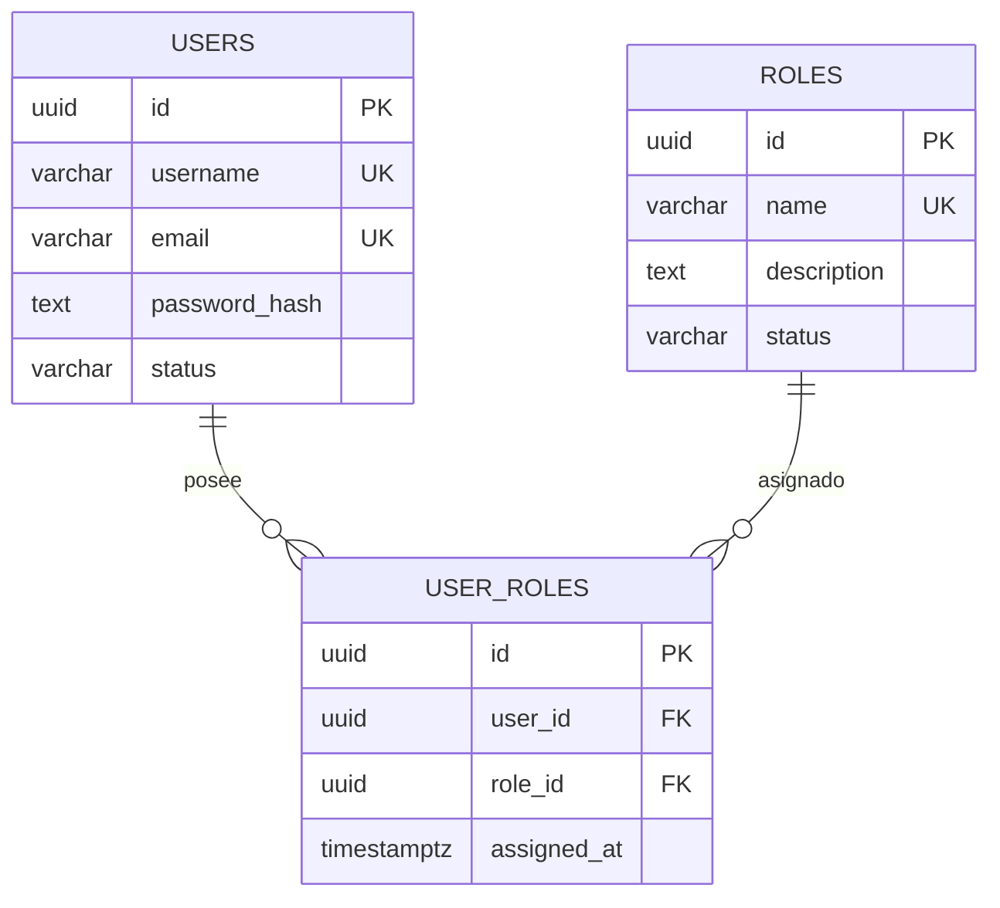

# 🛡️ IntiLink — Backend V1 (AUTH + STEGO)
### Proyecto Integrador del Primer Parcial
**Universidad de las Fuerzas Armadas ESPE — Innovación para la excelencia**  
**Departamento de Ciencias de la Computación**  
**Materia:** Desarrollo Software Seguro  

---

## 📋 Resumen Ejecutivo

**IntiLink Backend V1** constituye la base de seguridad para una plataforma de mensajería y salas de chat seguras. El sistema implementa una arquitectura desacoplada en **dos microservicios REST autónomos** bajo los enfoques de **Zero Trust**, **Secure by Design** y **Shift Left Security**, tomando como referencia los estándares **ISO/IEC 27001**, **ISO/IEC 27034** y **OWASP ASVS v5.0**:

1. **Microservicio AUTH (Puerto 4000):** Autoridad central de identidades y control de acceso. Administra usuarios, roles y su relación muchos a muchos (N:M) en PostgreSQL, almacena contraseñas mediante **Argon2id**, emite **JWT asimétricos (RS256)** con expiración acotada a 15 minutos y resuelve la autorización RBAC consultando la base de datos en tiempo real.
2. **Microservicio STEGO (Puerto 5000):** Analizador esteganográfico de imágenes (PNG y BMP). Valida firmas binarias reales (Magic Bytes), tipos MIME y tamaños en memoria. Aplica análisis estadístico de bit menos significativo (**LSB**) únicamente después de verificar la validez criptográfica del JWT y consultar a AUTH la autorización vigente del usuario.

```
                 Cliente REST / Thunder Client
                    │                     │
                    ▼                     ▼
        ┌──────────────────────┐    ┌──────────────────────────┐
        │ AUTH-SERVICE (:4000) │    │ STEGO-SERVICE (:5000)    │
        │ • Users, Roles (N:M) │◄───│ • Validación Magic Bytes │
        │ • Argon2id / RS256   │(1) │ • Análisis LSB           │
        │ • PostgreSQL (:5433) │    │ • Sin acceso a DB users  │
        └──────────────────────┘    └──────────────────────────┘
           (1) Consulta interna: POST /internal/authorization/check
```

---

## 🔒 Principios de Seguridad Implementados

* **Zero Trust (Confianza Cero):** Un JWT válido no es sinónimo de permiso eterno. STEGO verifica localmente la firma del token con la clave pública de AUTH, pero **siempre** consulta la autorización activa antes de procesar una imagen. La revocación de un rol surte efecto inmediato en la siguiente petición.
* **Separación de Responsabilidades y Mínimo Privilegio:** STEGO no se conecta a la base de datos de usuarios ni tiene acceso a la clave privada RSA.
* **Fallo Seguro (Fail-Safe Defaults):** Si AUTH se encuentra inaccesible, STEGO deniega inmediatamente la petición (`403 Forbidden - auth_unavailable`) sin procesar el archivo.
* **Higiene en Bitácoras (DLP):** Los registros de auditoría (`[AUDIT]`) enmascaran los tokens JWT (`Bearer eyJhbG...VzH6DBrQ`) y omiten contraseñas o claves privadas.

---

## 🚀 Requisitos Previos

* **Docker** (versión 20.10 o superior)
* **Docker Compose** (versión 2.0 o superior)
* Cliente REST para pruebas: **Thunder Client** (extensión de VS Code) o **Postman**
* *(Opcional)* Python 3 para ejecutar el script de generación de imágenes de prueba.

---

## 📦 Instalación y Puesta en Marcha Rápida

### 1. Clonar el repositorio
```bash
git clone <URL_DEL_REPOSITORIO>
cd IntiLink
```

### 2. Configurar variables de entorno
Ambos microservicios cuentan con sus respectivos archivos `.env.example`:
```bash
cp auth-service/.env.example auth-service/.env
cp stego-service/.env.example stego-service/.env
```

### 3. Construir e iniciar los contenedores
```bash
docker compose up --build -d
```
Esto levantará tres contenedores:
* `intilink-auth-db-1`: PostgreSQL 15 en el puerto host `5433` (interno `5432`).
* `intilink-auth-service-1`: Servicio AUTH en el puerto `4000`.
* `intilink-stego-service-1`: Servicio STEGO en el puerto `5000`.

### 4. Inicializar tablas y roles (Migraciones)
Las tablas y roles base (`ADMIN`, `ANALYST`, `USER`) se configuran automáticamente al iniciar el servicio. También pueden aplicarse directamente ejecutando:
```bash
docker compose exec auth-db psql -U auth_user -d auth_db -c "
CREATE EXTENSION IF NOT EXISTS \"uuid-ossp\";
CREATE TABLE IF NOT EXISTS users (
  id UUID PRIMARY KEY DEFAULT uuid_generate_v4(),
  username VARCHAR(50) UNIQUE NOT NULL,
  email VARCHAR(100) UNIQUE NOT NULL,
  password_hash TEXT NOT NULL,
  status VARCHAR(20) NOT NULL DEFAULT 'active',
  created_at TIMESTAMP WITH TIME ZONE DEFAULT NOW(),
  updated_at TIMESTAMP WITH TIME ZONE DEFAULT NOW()
);
CREATE TABLE IF NOT EXISTS roles (
  id UUID PRIMARY KEY DEFAULT uuid_generate_v4(),
  name VARCHAR(50) UNIQUE NOT NULL,
  description TEXT,
  status VARCHAR(20) NOT NULL DEFAULT 'active',
  created_at TIMESTAMP WITH TIME ZONE DEFAULT NOW(),
  updated_at TIMESTAMP WITH TIME ZONE DEFAULT NOW()
);
CREATE TABLE IF NOT EXISTS user_roles (
  id UUID PRIMARY KEY DEFAULT uuid_generate_v4(),
  user_id UUID NOT NULL REFERENCES users(id) ON DELETE CASCADE,
  role_id UUID NOT NULL REFERENCES roles(id) ON DELETE CASCADE,
  assigned_at TIMESTAMP WITH TIME ZONE DEFAULT NOW(),
  UNIQUE(user_id, role_id)
);
CREATE INDEX IF NOT EXISTS idx_user_roles_user_id ON user_roles(user_id);
CREATE INDEX IF NOT EXISTS idx_user_roles_role_id ON user_roles(role_id);
INSERT INTO roles (name, description, status) VALUES
  ('ADMIN', 'Administrator', 'active'),
  ('ANALYST', 'Analyst', 'active'),
  ('USER', 'User', 'active')
ON CONFLICT (name) DO NOTHING;
"
```

### 5. Generar imágenes de prueba (LSB)
Para realizar las pruebas de esteganografía con muestras reproducibles:
```bash
python3 generar_imagenes.py
```
Generará:
* `imagen_limpia.png` y `muestra_limpia.bmp` (ratio LSB ~0.49 ➔ `sin_indicios`).
* `imagen_con_lsb.png` y `muestra_con_lsb.bmp` (ratio LSB ~0.99 ➔ `sospechoso` / `cuarentena`).

---

## 📡 Catálogo de APIs y Contrato de Endpoints

### Microservicio AUTH (`http://localhost:4000`)

| Método | Ruta | Acceso Requerido | Descripción | Códigos HTTP |
|---|---|---|---|:---:|
| `POST` | `/api/auth/login` | Público (Rate limit: 10/min) | Inicia sesión con Argon2id y emite JWT RS256 | 200, 401 |
| `GET` | `/api/auth/profile` | Autenticado (Cualquier rol) | Retorna datos del usuario y sus roles vigentes | 200, 401 |
| `POST` | `/api/auth/logout` | Autenticado | Cierre de sesión seguro | 200, 401 |
| `POST` | `/api/users` | Rol `ADMIN` | Registra nuevos usuarios con contraseña hasheada | 201, 400, 403 |
| `GET` | `/api/users` | Rol `ADMIN` | Lista usuarios registrados | 200, 403 |
| `PATCH` | `/api/users/:id` | Rol `ADMIN` | Modifica estado o datos del usuario | 200, 400, 403 |
| `POST` | `/api/roles` | Rol `ADMIN` | Crea nuevos roles | 201, 400, 403 |
| `GET` | `/api/roles` | Rol `ADMIN` | Lista catálogo de roles | 200, 403 |
| `PATCH` | `/api/roles/:id` | Rol `ADMIN` | Actualiza descripción o estado de un rol | 200, 400, 403 |
| `POST` | `/api/user-roles` | Rol `ADMIN` | Asocia usuario y rol (N:M con `UNIQUE`) | 201, 409, 403 |
| `GET` | `/api/user-roles` | Rol `ADMIN` | Lista todas las asignaciones de roles e IDs | 200, 403 |
| `DELETE` | `/api/user-roles/:id` | Rol `ADMIN` | Revoca un rol eliminando la asignación | 200, 403 |
| `POST` | `/internal/authorization/check` | Servicio STEGO (`x-service-token`) | Consulta vigencia de permisos en tiempo real | 200, 401, 403 |

### Microservicio STEGO (`http://localhost:5000`)

| Método | Ruta | Acceso Requerido | Descripción | Códigos HTTP |
|---|---|---|---|:---:|
| `POST` | `/api/steganography/analyze` | Roles `ADMIN` o `ANALYST` | Analiza imagen (`file`) mediante heurística LSB | 200, 400, 401, 403, 413, 415 |
| `GET` | `/api/steganography/results/:id` | Dueño del análisis / RBAC | Consulta resultado de análisis por ID | 200, 401, 403, 404 |

---

## 🗃️ Modelo de Datos (Relación N:M)

La asociación de muchos a muchos está modelada formalmente en PostgreSQL:



* Restricción compuesta: `UNIQUE(user_id, role_id)` que garantiza que un usuario no pueda recibir privilegios duplicados (retorna `409 Conflict`).

---

## 🔍 Detección Esteganográfica y Políticas de Seguridad

El microservicio STEGO procesa imágenes PNG y BMP inspeccionando la distribución del bit menos significativo (LSB):
1. **Validación Previa:** Comprueba Magic Bytes (`0x89504E47` para PNG, `0x424D` para BMP), tipo MIME y tamaño máximo (5 MB).
2. **Cálculo de Anomalía:** Evalúa el ratio de unos y ceros en los bits LSB y su desviación de la distribución natural:
   $$\text{anomaly\_score} = \min(1.0, |\text{ratio} - 0.50| \times 10)$$
3. **Clasificación y Política:**
   * `anomaly_score >= 0.75` ➔ Estado **`sospechoso`** ➔ Acción: **`cuarentena`**.
   * `anomaly_score >= 0.40` ➔ Estado **`sin_indicios`** ➔ Acción: **`advertencia`**.
   * `anomaly_score < 0.40` ➔ Estado **`sin_indicios`** ➔ Acción: **`ninguna`**.

---

## 🧪 Batería de Pruebas (T01 a T12)

El sistema cuenta con una guía completa paso a paso para reproducir los 12 escenarios de prueba exigidos en la rúbrica de evaluación:

👉 **[Ver Guía Completa de Pruebas T01 a T12](docs/guia_pruebas_T01_T12.md)**

| ID | Escenario | Resultado Verificable |
|:---:|---|---|
| **T01** | Independencia de servicios | Contenedores iniciados y detenidos por separado sin colapso. |
| **T02** | Login válido e inválido | Emisión de JWT RS256 (`200 OK`) o rechazo (`401 Unauthorized`). |
| **T03** | STEGO sin token o falsificado | Denegación inmediata con código HTTP `401 Unauthorized`. |
| **T04** | Rol USER intenta analizar | Denegación por RBAC con código HTTP `403 Forbidden`. |
| **T05** | Asociación N:M | Usuarios con múltiples roles y roles asignados a múltiples usuarios. |
| **T06** | Asignación duplicada | Rechazo con código HTTP `409 Conflict` por restricción `UNIQUE`. |
| **T07** | Revocación en vivo (Zero Trust) | Eliminación de rol bloquea nueva operación con el mismo JWT activo. |
| **T08** | Fallo seguro (AUTH caído) | STEGO rechaza solicitudes (`403 Forbidden`) si no puede consultar a AUTH. |
| **T09** | Análisis LSB real | `imagen_limpia.png` (`sin_indicios`) vs `imagen_con_lsb.png` (`sospechoso`). |
| **T10** | Carga de archivo inválido | Rechazo con `415 Unsupported Media Type` o `400 Bad Request`. |
| **T11** | Recurso ajeno (IDOR) | Usuario regular no puede consultar análisis de otro usuario (`403`). |
| **T12** | Bitácoras de auditoría | Registros `[AUDIT]` trazables con JWTs enmascarados y sin contraseñas. |

---

## 📚 Documentación Técnica Complementaria

* [Arquitectura de Microservicios y Límites de Confianza](docs/arquitectura.md)
* [Diagrama Entidad-Relación y Esquema Relacional](docs/ERD.md)
* [Matriz de Activos, Amenazas, Riesgos y Controles (ISO/IEC 27001 / 27034)](docs/matriz_riesgos.md)
* [Especificación OpenAPI 3.0 — AUTH Service](docs/openapi-auth.yaml)
* [Especificación OpenAPI 3.0 — STEGO Service](docs/openapi-stego.yaml)
* [Colección de Solicitudes Thunder Client](postman/thunder-collection_IntiLink.json)
* [Colección de Solicitudes Postman](postman/IntiLink.postman_collection.json)

---

## 👥 Autores y Calificación
* **Materia:** Desarrollo Software Seguro
* **Proyecto Integrador:** Primer Parcial — Backend V1
* **Universidad de las Fuerzas Armadas ESPE** (Noviembre 2026)
