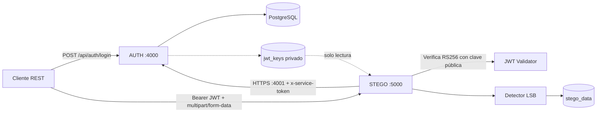
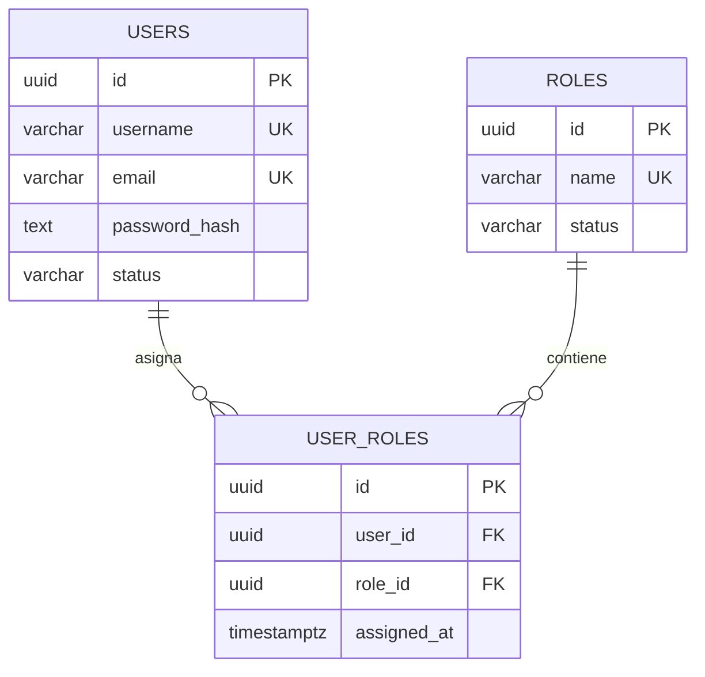
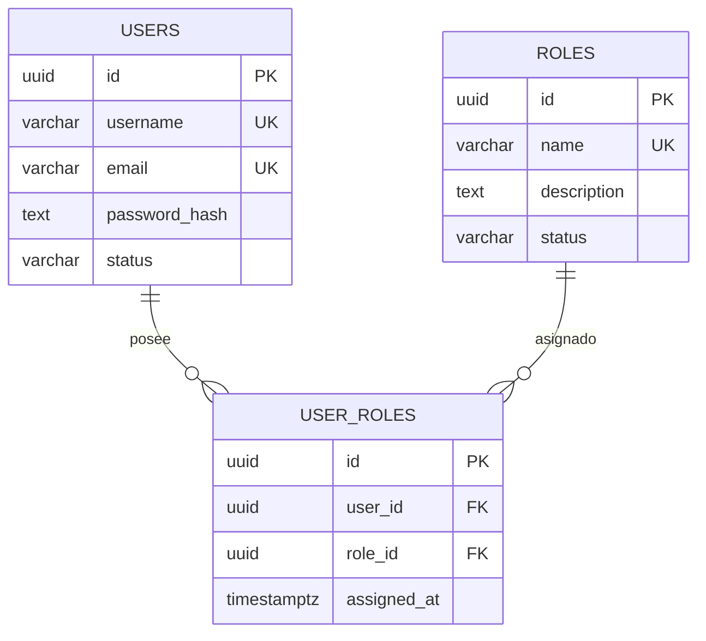

# 🛡️ IntiLink — Backend V1 (AUTH + STEGO)
### Proyecto Integrador del Primer Parcial
**Universidad de las Fuerzas Armadas ESPE — Innovación para la excelencia**  
**Departamento de Ciencias de la Computación**  
**Materia:** Desarrollo Software Seguro  

---

## 📋 Resumen Ejecutivo

**IntiLink Backend V1** constituye la base de seguridad para una plataforma de mensajería y salas de chat seguras. El sistema implementa una arquitectura desacoplada en **dos microservicios REST autónomos** bajo los enfoques de **Zero Trust**, **Secure by Design** y **Shift Left Security**, tomando como referencia los estándares **ISO/IEC 27001**, **ISO/IEC 27034** y **OWASP ASVS v5.0**:

1. **Microservicio AUTH (Puerto 4000):** Autoridad central de identidades y control de acceso. Administra usuarios, roles y su relación muchos a muchos (N:M) en PostgreSQL, almacena contraseñas mediante **Argon2id**, emite **JWT asimétricos (RS256)** con expiración acotada a 15 minutos y resuelve la autorización RBAC consultando la base de datos en tiempo real.
2. **Microservicio STEGO (Puerto 5000):** Analizador esteganográfico de imágenes PNG y BMP. Valida Magic Bytes, MIME, tamaño y decodificación real de píxeles. Aplica análisis estadístico del bit menos significativo (**LSB**) sólo después de verificar el JWT y consultar a AUTH la autorización vigente.

```
                 Cliente REST / Thunder Client
                    │                     │
                    ▼                     ▼
        ┌──────────────────────┐    ┌──────────────────────────┐
        │ AUTH-SERVICE (:4000) │    │ STEGO-SERVICE (:5000)    │
        │ • Users, Roles (N:M) │◄───│ • Validación Magic Bytes │
        │ • Argon2id / RS256   │(1) │ • Análisis LSB           │
        │ • PostgreSQL (red interna)│  │ • Sin acceso a DB users  │
        └──────────────────────┘    └──────────────────────────┘
           (1) Consulta interna: HTTPS :4001 /internal/authorization/check
```

---

## 🔒 Principios de Seguridad Implementados

* **Zero Trust (Confianza Cero):** Un JWT válido no es sinónimo de permiso eterno. STEGO verifica localmente la firma del token con la clave pública de AUTH, pero **siempre** consulta la autorización activa antes de procesar una imagen. La revocación de un rol surte efecto inmediato en la siguiente petición.
* **Separación de Responsabilidades y Mínimo Privilegio:** STEGO no se conecta a la base de datos de usuarios ni tiene acceso a la clave privada RSA.
* **Fallo Seguro (Fail-Safe Defaults):** Si AUTH se encuentra inaccesible, STEGO deniega inmediatamente la petición (`403 Forbidden - auth_unavailable`) sin procesar el archivo.
* **Validación y revocación:** AUTH comprueba algoritmo, firma, emisor, audiencia y vigencia del JWT, y consulta usuarios y roles activos en cada decisión RBAC. Revocar una asignación bloquea nuevas operaciones aunque el JWT no haya expirado.
* **Canal interno protegido:** STEGO consulta AUTH por HTTPS en el puerto interno `4001`, valida el certificado y utiliza `x-service-token`. Ese puerto no se publica al host.
* **Protección de bitácoras:** Los eventos `[AUDIT]` registran accesos,
  decisiones y resultados sin exponer contraseñas, claves privadas ni JWT
  completos.
* **Higiene en Bitácoras (DLP):** Los registros de auditoría (`[AUDIT]`) enmascaran los tokens JWT (`Bearer eyJhbG...VzH6DBrQ`) y omiten contraseñas o claves privadas.

---

## 🚀 Requisitos Previos

* **Docker** (versión 20.10 o superior)
* **Docker Compose** (versión 2.0 o superior)
* Cliente REST para pruebas: **Thunder Client** (extensión de VS Code) o **Postman**
* *(Opcional)* Python 3 para ejecutar el script de generación de imágenes de prueba.

---

## 📦 Instalación y Puesta en Marcha Rápida

### 1. Clonar el repositorio
```bash
git clone <URL_DEL_REPOSITORIO>
cd IntiLink
```

### 2. Configurar variables de entorno
Cada servicio usa su propio `.env` (ignorado por Git). Las claves JWT y TLS se generan automáticamente dentro del volumen privado `jwt_keys`:
```bash
cp auth-service/.env.example auth-service/.env
cp stego-service/.env.example stego-service/.env
```

### 3. Construir e iniciar los contenedores
```bash
docker compose up --build -d
```
Esto levantará tres contenedores:
* `intilink-auth-db-1`: PostgreSQL 15 accesible solo dentro de la red interna de Docker (puerto interno `5432`).
* `intilink-auth-service-1`: Servicio AUTH en el puerto `4000`.
* `intilink-stego-service-1`: Servicio STEGO en el puerto `5000`.
* `auth_db_data`: Persistencia de usuarios, roles y asignaciones.
* `jwt_keys`: Claves JWT y certificados TLS privados de Docker.
* `stego_data`: Resultados persistentes y archivos sospechosos en cuarentena.

### 4. Inicializar tablas y roles (Migraciones)
Las tablas y roles base (`ADMIN`, `ANALYST`, `USER`) se configuran automáticamente al iniciar el servicio. También pueden aplicarse directamente ejecutando:
```bash
docker compose exec auth-db psql -U auth_user -d auth_db -c "
CREATE EXTENSION IF NOT EXISTS \"uuid-ossp\";
CREATE TABLE IF NOT EXISTS users (
  id UUID PRIMARY KEY DEFAULT uuid_generate_v4(),
  username VARCHAR(50) UNIQUE NOT NULL,
  email VARCHAR(100) UNIQUE NOT NULL,
  password_hash TEXT NOT NULL,
  status VARCHAR(20) NOT NULL DEFAULT 'active',
  created_at TIMESTAMP WITH TIME ZONE DEFAULT NOW(),
  updated_at TIMESTAMP WITH TIME ZONE DEFAULT NOW()
);
CREATE TABLE IF NOT EXISTS roles (
  id UUID PRIMARY KEY DEFAULT uuid_generate_v4(),
  name VARCHAR(50) UNIQUE NOT NULL,
  description TEXT,
  status VARCHAR(20) NOT NULL DEFAULT 'active',
  created_at TIMESTAMP WITH TIME ZONE DEFAULT NOW(),
  updated_at TIMESTAMP WITH TIME ZONE DEFAULT NOW()
);
CREATE TABLE IF NOT EXISTS user_roles (
  id UUID PRIMARY KEY DEFAULT uuid_generate_v4(),
  user_id UUID NOT NULL REFERENCES users(id) ON DELETE CASCADE,
  role_id UUID NOT NULL REFERENCES roles(id) ON DELETE CASCADE,
  assigned_at TIMESTAMP WITH TIME ZONE DEFAULT NOW(),
  UNIQUE(user_id, role_id)
);
CREATE INDEX IF NOT EXISTS idx_user_roles_user_id ON user_roles(user_id);
CREATE INDEX IF NOT EXISTS idx_user_roles_role_id ON user_roles(role_id);
INSERT INTO roles (name, description, status) VALUES
  ('ADMIN', 'Administrator', 'active'),
  ('ANALYST', 'Analyst', 'active'),
  ('USER', 'User', 'active')
ON CONFLICT (name) DO NOTHING;
"
```

### 5. Generar imágenes de prueba (LSB)
Para realizar las pruebas de esteganografía con muestras reproducibles:
```bash
python3 generar_imagenes.py
```
Generará:
* `imagen_limpia.png` y `muestra_limpia.bmp` (ratio LSB ~0.49 ➔ `sin_indicios`).
* `imagen_con_lsb.png` y `muestra_con_lsb.bmp` (ratio LSB ~0.99 ➔ `sospechoso` / `cuarentena`).

---

## 🏗️ Arquitectura y flujo de confianza



### Límites de confianza

- **Cliente:** zona no confiable; nunca se aceptan roles enviados por el cliente.
- **AUTH:** única autoridad para usuarios, roles, asignaciones y decisiones RBAC.
- **STEGO:** no tiene conexión a PostgreSQL ni acceso a la clave privada JWT.
- **AUTH–STEGO:** autorización por HTTPS interno en `auth-service:4001`, certificado
  validado y `x-service-token`; ante error se deniega por defecto.
- **Almacenamiento:** `auth_db_data` conserva identidad; `stego_data` conserva
  resultados y cuarentena; `jwt_keys` conserva secretos sólo dentro de Docker.

### Flujo de una operación protegida

1. El cliente inicia sesión en AUTH y recibe un JWT RS256 con `sub`, `iss`, `aud`
   y expiración de 15 minutos.
2. STEGO verifica localmente firma, algoritmo, emisor, audiencia y vigencia.
3. STEGO solicita a AUTH una decisión fresca para `steganography.analyze`.
4. AUTH consulta `users`, `roles` y `user_roles` activos.
5. Sólo con `allowed: true` STEGO decodifica y analiza la imagen.
6. La revocación del rol se aplica inmediatamente en la siguiente petición.

## 🧩 Modelo de identidad y RBAC



La tabla `user_roles` implementa la relación N:M con claves foráneas,
`ON DELETE CASCADE`, índices y `UNIQUE(user_id, role_id)`.

| Acción | ADMIN | ANALYST | USER |
|---|:---:|:---:|:---:|
| Administrar usuarios, roles y asignaciones | ✅ | ❌ | ❌ |
| Consultar perfil | ✅ | ✅ | ✅ |
| Analizar imágenes en STEGO | ✅ | ✅ | ❌ |
| Consultar resultado propio | ✅ | ✅ | ❌ |

## 📡 Catálogo de APIs y Contrato de Endpoints

### Microservicio AUTH (`http://localhost:4000`)

| Método | Ruta | Acceso Requerido | Descripción | Códigos HTTP |
|---|---|---|---|:---:|
| `POST` | `/api/auth/login` | Público (Rate limit: 10/min) | Inicia sesión con Argon2id y emite JWT RS256 | 200, 401 |
| `GET` | `/api/auth/profile` | Autenticado (Cualquier rol) | Retorna datos del usuario y sus roles vigentes | 200, 401 |
| `POST` | `/api/auth/logout` | Autenticado | Cierre de sesión seguro | 200, 401 |
| `POST` | `/api/users` | Rol `ADMIN` | Registra nuevos usuarios con contraseña hasheada | 201, 400, 403 |
| `GET` | `/api/users` | Rol `ADMIN` | Lista usuarios registrados | 200, 403 |
| `PATCH` | `/api/users/:id` | Rol `ADMIN` | Modifica estado o datos del usuario | 200, 400, 403 |
| `POST` | `/api/roles` | Rol `ADMIN` | Crea nuevos roles | 201, 400, 403 |
| `GET` | `/api/roles` | Rol `ADMIN` | Lista catálogo de roles | 200, 403 |
| `PATCH` | `/api/roles/:id` | Rol `ADMIN` | Actualiza descripción o estado de un rol | 200, 400, 403 |
| `POST` | `/api/user-roles` | Rol `ADMIN` | Asocia usuario y rol (N:M con `UNIQUE`) | 201, 409, 403 |
| `GET` | `/api/user-roles` | Rol `ADMIN` | Lista todas las asignaciones de roles e IDs | 200, 403 |
| `DELETE` | `/api/user-roles/:id` | Rol `ADMIN` | Revoca un rol eliminando la asignación | 200, 403 |
| `POST` | `https://auth-service:4001/internal/authorization/check` | Sólo STEGO (`x-service-token`) | Consulta vigencia de permisos en tiempo real | 200, 401, 403 |

### Microservicio STEGO (`http://localhost:5000`)

| Método | Ruta | Acceso Requerido | Descripción | Códigos HTTP |
|---|---|---|---|:---:|
| `POST` | `/api/steganography/analyze` | Roles `ADMIN` o `ANALYST` | Analiza imagen (`file`) mediante heurística LSB | 200, 400, 401, 403, 413, 415 |
| `GET` | `/api/steganography/results/:id` | Dueño del análisis / RBAC | Consulta resultado de análisis por ID | 200, 401, 403, 404 |

---

## 🗃️ Modelo de Datos (Relación N:M)

La asociación de muchos a muchos está modelada formalmente en PostgreSQL:



* Restricción compuesta: `UNIQUE(user_id, role_id)` que garantiza que un usuario no pueda recibir privilegios duplicados (retorna `409 Conflict`).

---

## 🔍 Detección Esteganográfica y Políticas de Seguridad

El microservicio STEGO procesa imágenes PNG y BMP inspeccionando la distribución del bit menos significativo (LSB):
1. **Validación Previa:** Comprueba Magic Bytes (`0x89504E47` para PNG, `0x424D` para BMP), tipo MIME y tamaño máximo (5 MB).
2. **Cálculo de Anomalía:** Evalúa el ratio de unos y ceros en los bits LSB y su desviación de la distribución natural:
   $$\text{anomaly\_score} = \min(1.0, |\text{ratio} - 0.50| \times 10)$$
3. **Clasificación y Política:**
   * `anomaly_score >= 0.75` ➔ Estado **`sospechoso`** ➔ Acción: **`cuarentena`**.
   * `anomaly_score >= 0.40` ➔ Estado **`sin_indicios`** ➔ Acción: **`advertencia`**.
   * `anomaly_score < 0.40` ➔ Estado **`sin_indicios`** ➔ Acción: **`ninguna`**.

### Validaciones de archivos

- Extensiones permitidas: `.png` y `.bmp`.
- MIME permitido: `image/png` y `image/bmp`.
- Tamaño máximo: 5 MiB; excederlo devuelve `413`.
- Magic Bytes: firma PNG `89 50 4E 47 0D 0A 1A 0A`; firma BMP `42 4D`.
- PNG: se decodifica con `pngjs`; BMP: se valida encabezado, dimensiones,
  profundidad y compresión antes de leer píxeles.
- Los archivos se procesan en memoria; sólo los sospechosos se guardan en
  cuarentena con UUID y permisos privados.

### Resultado de análisis

```json
{
  "analysis_id": "uuid",
  "user_id": "uuid",
  "filename": "imagen.png",
  "sha256": "hash",
  "technique": "lsb_statistical_analysis",
  "status": "sospechoso",
  "indicators": {
    "anomaly_score": 1,
    "ratio": 1,
    "threshold": 0.75
  },
  "action": "cuarentena",
  "limitations": "Resultado indicativo, no concluyente"
}
```

## 🔐 Configuración y secretos

Los archivos `.env` locales no deben versionarse. Se proporcionan plantillas
en [`auth-service/.env.example`](auth-service/.env.example) y
[`stego-service/.env.example`](stego-service/.env.example).

Al iniciar Docker, AUTH genera en `jwt_keys`:

- `private.pem`: sólo AUTH lo utiliza para firmar.
- `public.pem`: STEGO lo utiliza para verificar.
- `tls.key` y `tls.crt`: canal HTTPS interno AUTH–STEGO.

Nunca se debe copiar `private.pem` al repositorio, mostrarlo en capturas o
compartirlo. Para reiniciar completamente las claves, detener los servicios y
eliminar únicamente el volumen nombrado `intilink_jwt_keys`.

## 📖 Procedimiento de ejecución y verificación funcional

Esta sección presenta una secuencia académica reproducible para iniciar el
entorno, verificar la comunicación entre servicios, administrar identidades,
comprobar la autorización basada en roles y analizar imágenes.

### 1. Preparación del entorno

Ejecute los siguientes comandos desde PowerShell:

```powershell
Set-Location C:\Users\LENOVO\Documents\Seguridad\IntiLink

Copy-Item auth-service\.env.example auth-service\.env -Force
Copy-Item stego-service\.env.example stego-service\.env -Force

docker compose config --quiet
docker compose up --build -d
docker compose ps
```

La salida debe mostrar los servicios `auth-db`, `auth-service` y
`stego-service` en estado `Up`. Las migraciones de AUTH se ejecutan
automáticamente al iniciar el contenedor e inicializan las entidades
`users`, `roles` y `user_roles`.

Verifique la disponibilidad de las APIs:

```powershell
curl.exe -i http://localhost:4000/health
curl.exe -i http://localhost:5000/health
```

Las respuestas esperadas son:

```json
{"status":"ok","service":"auth"}
{"status":"ok","service":"stego"}
```

AUTH expone la API pública en el puerto `4000`. STEGO expone su API en el
puerto `5000`. La comunicación de autorización entre servicios se realiza
por HTTPS en `auth-service:4001`, dentro de la red de Docker, y no se publica
directamente en el equipo anfitrión.

### 2. Autenticación de usuarios

La migración crea un usuario administrativo inicial:

```text
Usuario: admin
Contraseña: Admin123!
Rol: ADMIN
```

Compruebe el rechazo de credenciales incorrectas:

```powershell
curl.exe -i -X POST http://localhost:4000/api/auth/login `
  -H "Content-Type: application/json" `
  -d '{"username":"admin","password":"CredencialIncorrecta"}'
```

El resultado esperado es `401 Unauthorized`.

Después, realice un inicio de sesión válido y conserve el token sólo en la
sesión de PowerShell:

```powershell
$login = curl.exe -sS -X POST http://localhost:4000/api/auth/login `
  -H "Content-Type: application/json" `
  -d '{"username":"admin","password":"Admin123!"}' | ConvertFrom-Json

$adminToken = $login.access_token
Write-Output ("Tipo: " + $login.token_type)
Write-Output ("Expiración: " + $login.expires_in)
```

La respuesta debe indicar `Bearer` y una expiración de `15m`. El token se
firma con RS256, contiene el identificador del usuario en `sub` y se valida
con emisor, audiencia, algoritmo y vigencia.

Compruebe el perfil autenticado:

```powershell
curl.exe -i http://localhost:4000/api/auth/profile `
  -H "Authorization: Bearer $adminToken"
```

La respuesta debe incluir el usuario y sus roles vigentes. Las contraseñas
persistidas no son reversibles: AUTH las almacena mediante Argon2id.

### 3. Administración de usuarios, roles y relación N:M

Cree dos usuarios con responsabilidades diferentes:

```powershell
curl.exe -sS -X POST http://localhost:4000/api/users `
  -H "Authorization: Bearer $adminToken" `
  -H "Content-Type: application/json" `
  -d '{"username":"analyst1","email":"analyst1@demo.local","password":"Analyst123!"}'

curl.exe -sS -X POST http://localhost:4000/api/users `
  -H "Authorization: Bearer $adminToken" `
  -H "Content-Type: application/json" `
  -d '{"username":"user1","email":"user1@demo.local","password":"User123!"}'
```

Obtenga los identificadores necesarios:

```powershell
$users = curl.exe -sS http://localhost:4000/api/users `
  -H "Authorization: Bearer $adminToken" | ConvertFrom-Json
$roles = curl.exe -sS http://localhost:4000/api/roles `
  -H "Authorization: Bearer $adminToken" | ConvertFrom-Json

$analystId = ($users | Where-Object username -eq "analyst1").id
$userId = ($users | Where-Object username -eq "user1").id
$analystRoleId = ($roles | Where-Object name -eq "ANALYST").id
$userRoleId = ($roles | Where-Object name -eq "USER").id
```

Asigne roles mediante `user_roles`:

```powershell
curl.exe -i -X POST http://localhost:4000/api/user-roles `
  -H "Authorization: Bearer $adminToken" `
  -H "Content-Type: application/json" `
  -d "{`"user_id`":`"$analystId`",`"role_id`":`"$analystRoleId`"}"

curl.exe -i -X POST http://localhost:4000/api/user-roles `
  -H "Authorization: Bearer $adminToken" `
  -H "Content-Type: application/json" `
  -d "{`"user_id`":`"$userId`",`"role_id`":`"$userRoleId`"}"
```

Consulte las asignaciones:

```powershell
curl.exe -i http://localhost:4000/api/user-roles `
  -H "Authorization: Bearer $adminToken"
```

La tabla asociativa permite que un usuario tenga varios roles y que un rol
sea compartido por varios usuarios. Si se repite exactamente la misma
asignación, PostgreSQL aplica `UNIQUE(user_id, role_id)` y la API responde
`409 Conflict`.

### 4. Control de acceso basado en roles

Obtenga tokens para el analista y el usuario regular:

```powershell
$analystLogin = curl.exe -sS -X POST http://localhost:4000/api/auth/login `
  -H "Content-Type: application/json" `
  -d '{"username":"analyst1","password":"Analyst123!"}' | ConvertFrom-Json
$analystToken = $analystLogin.access_token

$userLogin = curl.exe -sS -X POST http://localhost:4000/api/auth/login `
  -H "Content-Type: application/json" `
  -d '{"username":"user1","password":"User123!"}' | ConvertFrom-Json
$userToken = $userLogin.access_token
```

Un usuario con rol `USER` no puede analizar imágenes:

```powershell
curl.exe -i -X POST http://localhost:5000/api/steganography/analyze `
  -H "Authorization: Bearer $userToken" `
  -F "file=@imagen_limpia.png"
```

El resultado esperado es `403 Forbidden` con una razón de insuficiencia de
rol. Sin cabecera `Authorization`, o con un JWT alterado, el resultado
esperado es `401 Unauthorized`.

### 5. Análisis de imágenes

Un usuario `ANALYST` puede analizar una imagen válida:

```powershell
$analysis = curl.exe -sS -X POST `
  http://localhost:5000/api/steganography/analyze `
  -H "Authorization: Bearer $analystToken" `
  -F "file=@imagen_limpia.png" | ConvertFrom-Json

$analysis
$analysisId = $analysis.analysis_id
```

Para una imagen limpia se espera `status: sin_indicios` y
`action: ninguna`. Analice la muestra con carga LSB:

```powershell
curl.exe -sS -X POST `
  http://localhost:5000/api/steganography/analyze `
  -H "Authorization: Bearer $analystToken" `
  -F "file=@imagen_con_lsb.png"
```

Se espera `status: sospechoso`, `action: cuarentena`, un `sha256` y un
`anomaly_score` igual o superior a `0.75`. El resultado es indicativo y no
constituye una prueba definitiva de esteganografía.

También se pueden analizar `muestra_limpia.bmp` y `muestra_con_lsb.bmp`.
Los resultados se almacenan en el volumen `stego_data`; los archivos
sospechosos se guardan en cuarentena con un nombre UUID y no se publican
directamente por HTTP.

Consulte un resultado propio:

```powershell
curl.exe -i http://localhost:5000/api/steganography/results/$analysisId `
  -H "Authorization: Bearer $analystToken"
```

El resultado de otro usuario debe responder `403 Forbidden`.

### 6. Revocación y denegación por defecto

Liste las asignaciones y obtenga el identificador de la asignación `ANALYST`:

```powershell
$assignments = curl.exe -sS http://localhost:4000/api/user-roles `
  -H "Authorization: Bearer $adminToken" | ConvertFrom-Json
$assignmentId = ($assignments | Where-Object {
  $_.user_id -eq $analystId -and $_.role_name -eq "ANALYST"
}).id
```

Revoque el rol:

```powershell
curl.exe -i -X DELETE `
  http://localhost:4000/api/user-roles/$assignmentId `
  -H "Authorization: Bearer $adminToken"
```

Use nuevamente el mismo `$analystToken`, sin iniciar sesión otra vez:

```powershell
curl.exe -i -X POST `
  http://localhost:5000/api/steganography/analyze `
  -H "Authorization: Bearer $analystToken" `
  -F "file=@imagen_limpia.png"
```

La nueva solicitud debe responder `403 Forbidden`. Esto demuestra que la
autorización se consulta en tiempo real y no depende únicamente de los roles
que existían cuando se emitió el JWT.

Para verificar el comportamiento ante indisponibilidad de AUTH:

```powershell
docker compose stop auth-service
curl.exe -i -X POST `
  http://localhost:5000/api/steganography/analyze `
  -H "Authorization: Bearer $analystToken" `
  -F "file=@imagen_limpia.png"
docker compose start auth-service
```

STEGO debe responder `403` con razón `auth_unavailable` y no debe procesar
ni persistir la imagen.

### 7. Validación de archivos y auditoría

Archivo no permitido:

```powershell
"contenido no válido" | Set-Content invalid.txt
curl.exe -i -X POST `
  http://localhost:5000/api/steganography/analyze `
  -H "Authorization: Bearer $adminToken" `
  -F "file=@invalid.txt"
```

El resultado esperado es `415 Unsupported Media Type` o `400 Bad Request`.
Un archivo mayor de 5 MiB debe responder `413 Payload Too Large`. Un archivo
renombrado como `.png` pero con firma inválida también debe ser rechazado.

Consulte los registros:

```powershell
docker compose logs --tail=50 auth-service
docker compose logs --tail=50 stego-service
```

Los registros deben permitir identificar inicios de sesión, decisiones de
autorización, accesos, hash de archivo, clasificación y política aplicada.
No deben contener contraseñas, claves privadas ni JWT completos.

### 8. Detención y validación de construcción

Para detener los contenedores sin eliminar los volúmenes:

```powershell
docker compose down
```

Para validar la construcción de ambos servicios:

```powershell
Set-Location auth-service
npm install
npm run build
npm audit --omit=dev

Set-Location ..\stego-service
npm install
npm run build
npm audit --omit=dev

Set-Location ..
docker compose config --quiet
```

Los comandos `build` deben finalizar correctamente y las auditorías deben
reportar `found 0 vulnerabilities`.

## ✅ Matriz de verificación funcional

| Criterio | Evidencia que debe presentarse |
|---|---|
| Arquitectura (3,0) | `docker compose ps`, ambos `/health`, parada independiente y OpenAPI |
| Identidad (3,0) | CRUD de usuarios/roles, `GET /api/user-roles`, asignaciones N:M y `409` |
| JWT (3,0) | Login `200/401`, Argon2id, RS256, `sub`, `iss`, `aud`, expiración |
| RBAC (4,0) | USER `403`, token inválido `401`, revocación `403`, AUTH caído `auth_unavailable` |
| STEGO (5,0) | PNG/BMP limpio y LSB, hash, indicadores, cuarentena y logs `[AUDIT]` |
| Pruebas (2,0) | T01–T12, OpenAPI, riesgos, colecciones y capturas reproducibles |

La guía con los comandos completos de sustentación está en
[`docs/README_INSTRUCCIONES.md`](docs/README_INSTRUCCIONES.md). La batería
formal T01–T12 también está en
[`docs/guia_pruebas_T01_T12.md`](docs/guia_pruebas_T01_T12.md).

---

## 🧪 Batería de Pruebas (T01 a T12)

El sistema cuenta con una guía completa paso a paso para reproducir los 12 escenarios funcionales y de seguridad:

👉 **[Ver Guía Completa de Pruebas T01 a T12](docs/guia_pruebas_T01_T12.md)**

| ID | Escenario | Resultado Verificable |
|:---:|---|---|
| **T01** | Independencia de servicios | Contenedores iniciados y detenidos por separado sin colapso. |
| **T02** | Login válido e inválido | Emisión de JWT RS256 (`200 OK`) o rechazo (`401 Unauthorized`). |
| **T03** | STEGO sin token o falsificado | Denegación inmediata con código HTTP `401 Unauthorized`. |
| **T04** | Rol USER intenta analizar | Denegación por RBAC con código HTTP `403 Forbidden`. |
| **T05** | Asociación N:M | Usuarios con múltiples roles y roles asignados a múltiples usuarios. |
| **T06** | Asignación duplicada | Rechazo con código HTTP `409 Conflict` por restricción `UNIQUE`. |
| **T07** | Revocación en vivo (Zero Trust) | Eliminación de rol bloquea nueva operación con el mismo JWT activo. |
| **T08** | Fallo seguro (AUTH caído) | STEGO rechaza solicitudes (`403 Forbidden`) si no puede consultar a AUTH. |
| **T09** | Análisis LSB real | `imagen_limpia.png` (`sin_indicios`) vs `imagen_con_lsb.png` (`sospechoso`). |
| **T10** | Carga de archivo inválido | Rechazo con `415 Unsupported Media Type` o `400 Bad Request`. |
| **T11** | Recurso ajeno (IDOR) | Usuario regular no puede consultar análisis de otro usuario (`403`). |
| **T12** | Bitácoras de auditoría | Registros `[AUDIT]` trazables con JWTs enmascarados y sin contraseñas. |

---

## 📚 Documentación Técnica Complementaria

* [README de instrucciones de ejecución](docs/README_INSTRUCCIONES.md)
* [Arquitectura de Microservicios y Límites de Confianza](docs/arquitectura.md)
* [Diagrama Entidad-Relación y Esquema Relacional](docs/ERD.md)
* [Matriz de Activos, Amenazas, Riesgos y Controles (ISO/IEC 27001 / 27034)](docs/matriz_riesgos.md)
* [Especificación OpenAPI 3.0 — AUTH Service](docs/openapi-auth.yaml)
* [Especificación OpenAPI 3.0 — STEGO Service](docs/openapi-stego.yaml)
* [Colección de Solicitudes Thunder Client](postman/thunder-collection_IntiLink.json)
* [Colección de Solicitudes Postman](postman/IntiLink.postman_collection.json)

## 🧪 Validación técnica

```powershell
Set-Location auth-service
npm install
npm run build
npm audit --omit=dev

Set-Location ..\stego-service
npm install
npm run build
npm audit --omit=dev

Set-Location ..
docker compose config --quiet
```

Los dos builds deben terminar correctamente y las auditorías deben indicar
`found 0 vulnerabilities`. Para detener el entorno:

```powershell
docker compose down
```

---

## 👥 Autores y Calificación
* **Materia:** Desarrollo Software Seguro
* **Proyecto Integrador:** Primer Parcial — Backend V1
* **Universidad de las Fuerzas Armadas ESPE** (Noviembre 2026)
