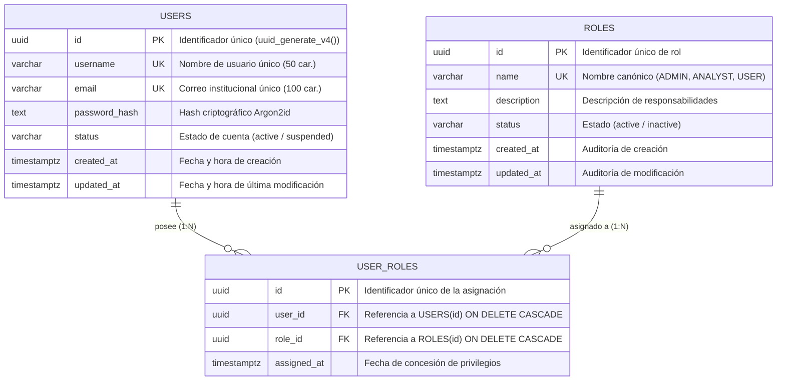

# 🗄️ Modelo de Datos y Diagrama Entidad-Relación (ERD) — IntiLink

**Módulo:** Microservicio AUTH  
**Motor de Base de Datos:** PostgreSQL 15  

---

## 1. Diagrama Entidad-Relación (Asociación N:M)



---

## 2. Restricciones de Integridad y Reglas de Negocio

1. **Relación Muchos a Muchos (N:M):**
   * Un usuario puede acumular múltiples roles (por ejemplo, `ADMIN` y `ANALYST`).
   * Un mismo rol puede estar conferido a múltiples usuarios simultáneamente.
2. **Restricción de Unicidad Compuesta:**
   ```sql
   UNIQUE(user_id, role_id)
   ```
   * Evita duplicidad de asignaciones, previniendo errores de concurrencia y elevación anómala de privilegios (probado en el escenario **T06**, retornando `409 Conflict`).
3. **Índices de Alto Rendimiento:**
   * `idx_user_roles_user_id` e `idx_user_roles_role_id` optimizan las consultas en tiempo real ejecutadas por `/internal/authorization/check`.
4. **Integridad Referencial:**
   * Claves foráneas con eliminación en cascada (`ON DELETE CASCADE`), garantizando consistencia si un usuario o rol es dado de baja.
