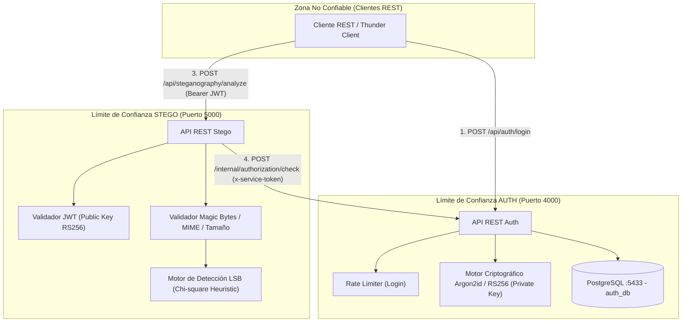

# 🏛️ Documento de Arquitectura de Software Seguro — IntiLink Backend V1

**Universidad de las Fuerzas Armadas ESPE**  
**Departamento de Ciencias de la Computación**  
**Materia:** Desarrollo Software Seguro  

---

## 1. Resumen Arquitectónico

IntiLink Backend V1 está concebido como una plataforma distribuida en **dos microservicios independientes** orientados al chat seguro:
* **Microservicio AUTH (Puerto 4000):** Autoridad centralizada de identidad, emisor de JSON Web Tokens (JWT) asimétricos (RS256) y administrador de usuarios y roles mediante persistencia relacional N:M (PostgreSQL).
* **Microservicio STEGO (Puerto 5000):** Analizador esteganográfico que inspecciona imágenes PNG y BMP mediante análisis estadístico del bit menos significativo (LSB).

---

## 2. Diagrama de Arquitectura y Límites de Confianza

---

## 3. Límites de Confianza y Reglas de Dominio

1. **Aislamiento de Persistencia:** STEGO **nunca** se conecta a la base de datos de AUTH. No conoce esquemas relacionales, contraseñas ni cadenas de conexión.
2. **Custodia de Claves Criptográficas:**
   * La clave privada RSA (`private.pem`) reside **única y exclusivamente** en el contenedor de AUTH.
   * STEGO solo posee la clave pública (`public.pem`), lo que le permite verificar la autenticidad del emisor pero le imposibilita forjar tokens.
3. **Canal Inter-Servicios Protegido:**
   * La comunicación entre STEGO y AUTH en `/internal/authorization/check` requiere un secreto compartido de infraestructura (`x-service-token`).
4. **Denegación por Defecto (Fail-Safe Defaults):**
   * Si la llamada inter-servicios falla (timeout, caída de contenedor o token inválido), STEGO responde `403 Forbidden` (`auth_unavailable`) y descarta el procesamiento del archivo.

---

## 4. Matriz de Roles y Permisos (RBAC)

El control de acceso basado en roles se evalúa en tiempo real contra los registros vigentes de la tabla asociativa `user_roles`:

| Recurso / Acción | ADMIN | ANALYST | USER | Público |
|---|:---:|:---:|:---:|:---:|
| `POST /api/auth/login` | ✅ | ✅ | ✅ | ✅ (con rate limit) |
| `GET /api/auth/profile` | ✅ | ✅ | ✅ | ❌ |
| `POST /api/auth/logout` | ✅ | ✅ | ✅ | ❌ |
| `POST/GET /api/users` | ✅ | ❌ | ❌ | ❌ |
| `PATCH /api/users/:id` | ✅ | ❌ | ❌ | ❌ |
| `POST/GET /api/roles` | ✅ | ❌ | ❌ | ❌ |
| `PATCH /api/roles/:id` | ✅ | ❌ | ❌ | ❌ |
| `POST/GET /api/user-roles` | ✅ | ❌ | ❌ | ❌ |
| `DELETE /api/user-roles/:id` | ✅ | ❌ | ❌ | ❌ |
| `POST /internal/authorization/check` | Solo servicio STEGO con cabecera `x-service-token` | | | |
| `POST /api/steganography/analyze` | ✅ | ✅ | ❌ | ❌ |
| `GET /api/steganography/results/:id` | ✅ (si es dueño) | ✅ (si es dueño) | ❌ | ❌ |

---

## 5. Implementación de Principios de Seguridad

* **Zero Trust:** Cada solicitud a STEGO desencadena una verificación de revocación activa en AUTH. Un JWT válido no garantiza autorización permanente.
* **Secure by Design:** La arquitectura separa responsabilidades (Separation of Concerns). Los archivos recibidos se tratan en memoria (`multer.memoryStorage()`) sin ejecución de código ni exposición pública.
* **Shift Left Security:** Validación estricta de extensiones, firmas reales (Magic Bytes `0x89 0x50 0x4E 0x47` para PNG y `0x42 0x4D` para BMP) antes de computar métricas LSB.
* **Data Loss Prevention (DLP):** Bitácoras depuradas donde los JWTs se enmascaran (`Bearer eyJhbG...VzH6DBrQ`) y jamás se imprimen contraseñas ni secretos criptográficos.
